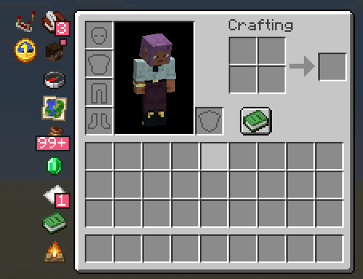
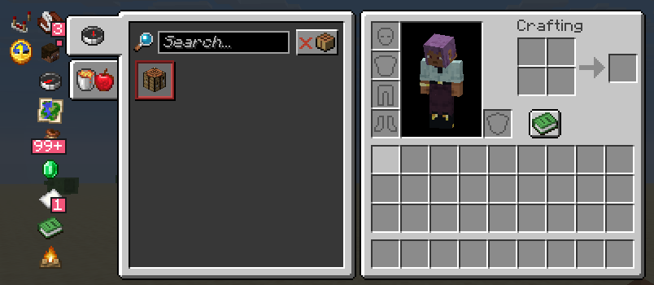
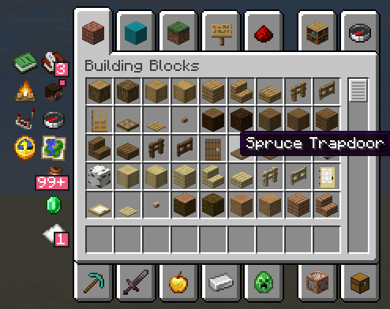
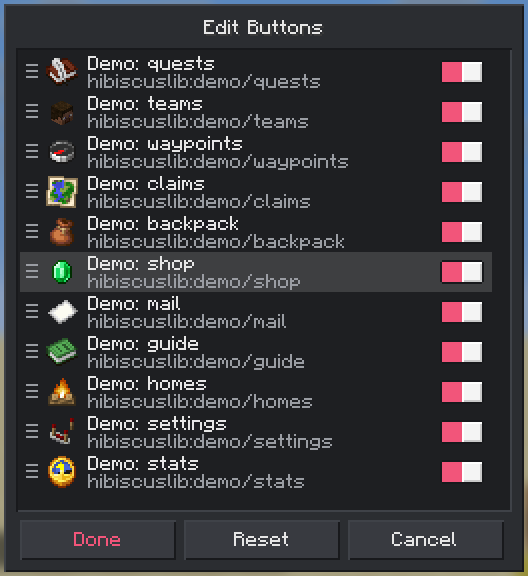
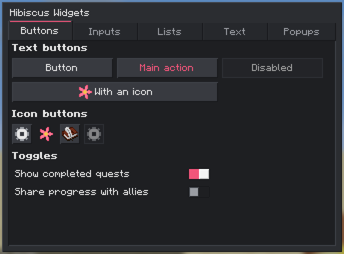
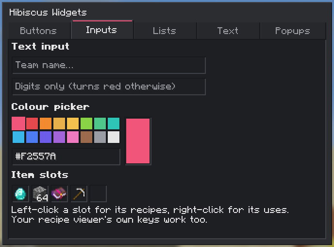
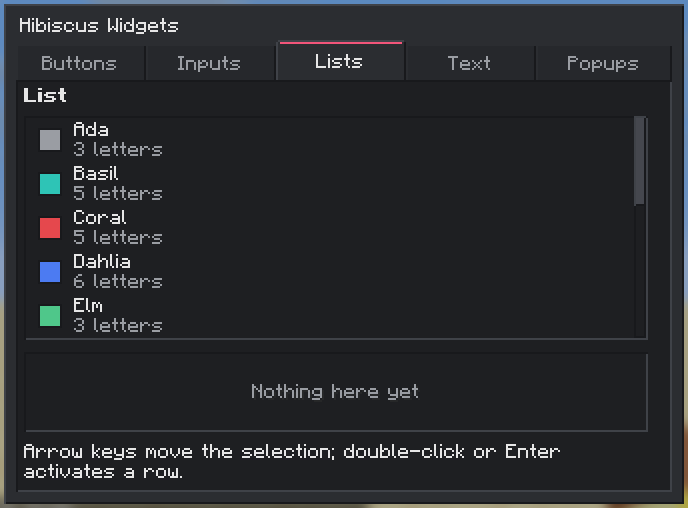
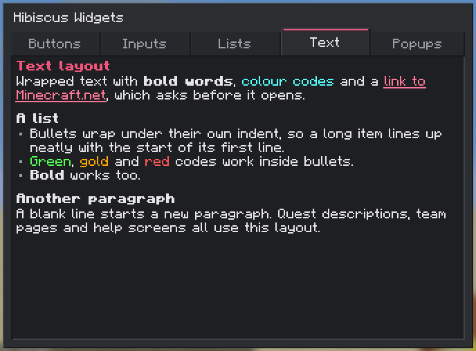
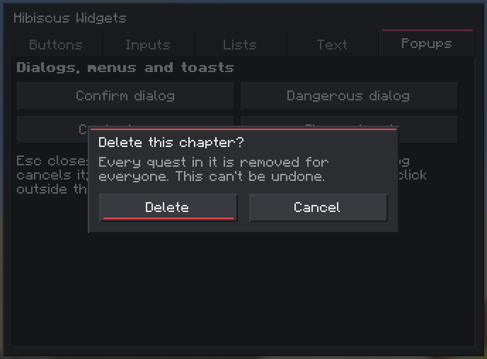
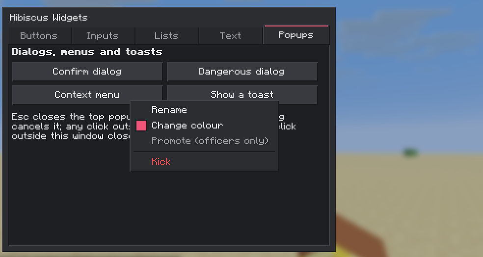

# Hibiscus Lib

The shared library behind the Hibiscus mods for NeoForge (Minecraft 26.3): the inventory button bar every Hibiscus
mod opens from, a themeable GUI toolkit, config and networking helpers, and the **Teams API** that lets mods keep
data per team whether or not a teams mod is installed.

On its own it adds no blocks or items; install it when a Hibiscus mod asks for it.

- **[Hibiscus Teams](https://github.com/hibiscus-software/hibiscus-teams)**: player teams, built on the Teams API.
- **[Hibiscus Quests](https://github.com/hibiscus-software/hibiscus-quests)**: a quest book with progress per team.

## The button bar

A column of small icon buttons beside the survival and creative inventories, one for each Hibiscus mod (and anything
a modpack adds). Badges show what's waiting: a number for unclaimed rewards, a dot for a pending invite.



It moves aside with the recipe book, wraps into more columns when there are many buttons, and keeps clear of JEI.




**Right-click any button** to choose which buttons show and drag them into order:



Settings live in `config/hibiscuslib-client.toml` (also under Mods → Hibiscus Lib → Config):

| Setting | What it does |
|---|---|
| `buttons.enabled` | show the bar at all |
| `buttons.location` | `top_left` (default), `top_right`, `bottom_left` or `left_column` |
| `buttons.hidden` | button ids to hide |
| `buttons.order` | button ids in the order to show them |

Buttons can have their own keys too: look for the **Hibiscus** section in Controls.

## For modpacks

**Add a button** that runs a command, with a resource pack file `assets/<namespace>/hibiscus_buttons/<name>.json`:

```json
{
  "icon": "minecraft:compass",
  "tooltip": "button.mypack.spawn",
  "command": "spawn",
  "order": 500
}
```

`icon` is an item id (or use `"sprite": "<namespace>:<gui sprite>"`), `tooltip` a lang key, and `command` runs as if
the player typed it (so it needs the player's own permission). Mods can register named actions for `"action"`
instead of `"command"`.

**Restyle every Hibiscus screen** with a resource pack: override `assets/hibiscuslib/hibiscus_theme/default.json`
with only the colours you want to change, and replace any sprite under `assets/hibiscuslib/textures/gui/sprites/`.

```json
{
  "colors": {
    "accent": "#4FC78A",
    "accent_hover": "#73E0A6"
  }
}
```

## The widget toolkit

Every Hibiscus screen is built from the same widgets and theme. The default theme is a neutral dark UI with a
hibiscus coral accent, and works from GUI scale 1 to 4.

| | |
|---|---|
|  |  |
|  |  |
|  |  |

Mod developers can open this gallery with `/hibiscuslib widgets` in a development environment (or with
`debug.widgetGallery = true` in `hibiscuslib-client.toml`).

## For mod developers

- [docs/DEPENDING.md](docs/DEPENDING.md): the Gradle setup, from GitHub Packages, and for developing Lib, Teams and
  Quests side by side.
- [docs/API.md](docs/API.md): the Teams API (with and without Hibiscus Teams), its events, and the toolkit's classes.

```java
// A button in the bar (client side, from your client mod constructor)
HibiscusButtons.register(Identifier.fromNamespaceAndPath(MODID, "quests"), ButtonSpec.builder()
        .item(() -> new ItemStack(Items.WRITABLE_BOOK))
        .tooltip(Component.translatable("button.mymod.quests"))
        .badge(() -> ButtonBadge.count(ClientQuests.unclaimedRewards()))
        .onClick(() -> Minecraft.getInstance().gui.setScreen(new QuestBookScreen(null)))
        .withKeyMapping()
        .build());

// Per-team data on the server, with or without a teams mod
Team team = TeamsApi.get().teamOf(player);
team.extraData(PROGRESS).putBoolean(questId, true);
team.markDirty();
```

## Building

Java 25 and the Gradle wrapper:

```sh
./gradlew build                 # the mod and API jars, in build/libs
./gradlew runGameTestServer     # the game tests
./gradlew runClient             # a dev client (with JEI)
./gradlew runScreenshotClient   # screenshots of the GUI at every scale, into run/screenshotClient/screenshots
```

Releases: [docs/RELEASING.md](docs/RELEASING.md). Changes: [CHANGELOG.md](CHANGELOG.md).

## License

[MIT](LICENSE). Hibiscus Lib is an original implementation: FTB Library inspired the button bar's behaviour, but no
code, textures or text come from it.
